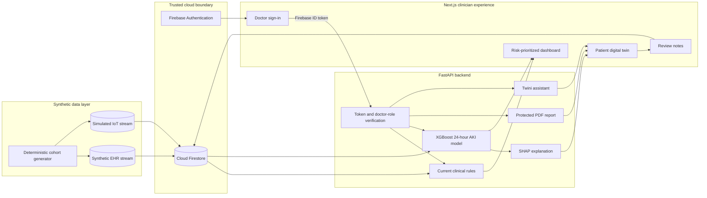

# TwinBean

<p align="center">
  
</p>

<p align="center">
  <strong>A synthetic kidney digital twin for early 24-hour acute kidney injury risk review</strong>
</p>

<p align="center">
  Happiest Health - Reimagining and Reforming Healthcare in India Summit 2026
</p>

> [!IMPORTANT]
> TwinBean is a research proof of concept built entirely with synthetic patient data and simulated medical-IoT observations. It is not a medical device, has not been clinically validated, and must not be used for diagnosis or treatment.

<p align="center">
  <a href="https://twinbean.vercel.app/"><strong>Live Demo</strong></a>
  &nbsp;&middot;&nbsp;
  <a href="https://docs.google.com/presentation/d/1jyrQI8YLM2UM95pPrBqGBxsJuASEmPam/edit?usp=sharing"><strong>Presentation</strong></a>
  &nbsp;&middot;&nbsp;
  <a href="https://drive.google.com/file/d/1iOhBH7e1AUC2HTvxhKT5BzyGBHJlsToT/view?usp=sharing"><strong>Architecture PDF</strong></a>
  &nbsp;&middot;&nbsp;
  <a href="https://youtu.be/INTJ57_fiSM"><strong>Demo Video</strong></a>
</p>

## Submission information

| Required item | Details |
|---|---|
| Project title | **TwinBean - Kidney Digital Twin for 24-Hour AKI Risk Review** |
| Team name | **TwinBean** |
| Team leader | **Supran Sekhar Panda** - B.Tech Computer Science and Engineering (Core) |
| Team member | **Shashwat Singh** - B.Tech Computer Science and Engineering (DSBS) |
| College / incubator | **SRM Institute of Science and Technology** |
| Healthcare use case | Predict and explain the risk of a new acute kidney injury (AKI) event within 24 hours for synthetic adults with chronic kidney disease (CKD). |
| Deployed application | [https://twinbean.vercel.app/](https://twinbean.vercel.app/) - **desktop viewing is recommended** |
| Demo video | [Watch the 15–20 minute TwinBean walkthrough on YouTube](https://youtu.be/INTJ57_fiSM) |
| Architecture | [Public Google Drive PDF](https://drive.google.com/file/d/1iOhBH7e1AUC2HTvxhKT5BzyGBHJlsToT/view?usp=sharing), [repository PDF](TwinBean%20System%20Architecture.pdf), and the Mermaid diagram below |
| Presentation | [Public Google Slides presentation](https://docs.google.com/presentation/d/1jyrQI8YLM2UM95pPrBqGBxsJuASEmPam/edit?usp=sharing) and [repository PPTX](TwinBean%20Presentation.pptx) |
| License | [MIT License](LICENSE) |

## Team details

| Name | Team role | Academic program | Institution |
|---|---|---|---|
| **Supran Sekhar Panda** | Team leader | B.Tech Computer Science and Engineering (Core) | SRM Institute of Science and Technology |
| **Shashwat Singh** | Team member | B.Tech Computer Science and Engineering (DSBS) | SRM Institute of Science and Technology |

The project uses **TwinBean** as the team name unless the competition registration uses a different official name.

## Live deployment

Open the deployed prototype at **[twinbean.vercel.app](https://twinbean.vercel.app/)**. For the intended clinician-dashboard layout and complete data tables, **use a desktop or laptop browser**.

### Demo login accounts

These accounts contain synthetic demonstration data only. They are public demo credentials, not administrator or production credentials.

| Email | Password |
|---|---|
| `doctor.demo@twinbean.test` | `doctor123` |
| `doctor.one@twinbean.test` | `doctor123` |
| `doctor.two@twinbean.test` | `doctor123` |

> [!CAUTION]
> Do not reuse these passwords for personal, college, Firebase administrator, email, or other accounts. Never upload Firebase service-account files, private keys, API keys, or production credentials to GitHub.

## Demo video

Watch the complete TwinBean prototype walkthrough on YouTube: **[TwinBean Demo Video](https://youtu.be/INTJ57_fiSM)**.

## Problem statement

CKD patients can deteriorate between periodic clinical reviews. Their longitudinal EHR history and home-monitoring observations often remain separated, making it harder for a clinician to review current renal evidence, detect an emerging AKI pattern, and understand a forecast in one place.

TwinBean demonstrates a focused digital twin that combines two explicitly separated streams:

1. **Static and historical EHR data** - synthetic demographics, CKD stage, encounters, medication history, creatinine, eGFR, BUN, and potassium.
2. **Dynamic medical-IoT data** - simulated weight, blood pressure, and heart-rate time series.

The prototype produces a time-stamped estimate of a new AKI event within the next 24 hours, while keeping observed clinical rules, model output, missing-data states, and SHAP feature influence visibly distinct.

## Healthcare use case

TwinBean supports a clinician reviewing a synthetic CKD cohort:

- Prioritize patients who currently meet creatinine-based review criteria.
- Review longitudinal kidney-function trends beside simulated home-monitoring observations.
- Inspect a future 24-hour AKI probability only when the required evidence is valid and fresh.
- See `Risk unavailable` instead of a misleading zero when prediction inputs are missing or stale.
- Review SHAP feature influence as a model explanation, never as causal or treatment guidance.
- Record doctor notes separately from generated evidence and download a patient-level PDF report.

## Prototype workflow

1. A deterministic generator creates a versioned synthetic CKD cohort.
2. A privileged backend script publishes the EHR and IoT streams to Cloud Firestore.
3. FastAPI verifies the Firebase ID token and requires the trusted `role: doctor` claim.
4. Clinical rules assess the current creatinine evidence.
5. The controlled XGBoost pipeline estimates 24-hour AKI risk from time-safe features.
6. The Next.js dashboard presents cohort priority, patient history, prediction status, SHAP influence, reports, and doctor notes.
7. Twini provides project-grounded educational assistance and optional synthetic-patient context through a backend-only Groq integration.

## Architecture



Security boundary: browser code never receives Firebase Admin credentials and never reads Firestore directly. Protected API routes accept only a verified Firebase token with the exact custom claim `role: doctor`.

## Technical stack

| Layer | Technology |
|---|---|
| Frontend | Next.js 16, React 19, TypeScript, Tailwind CSS 4, Recharts |
| Backend API | Python 3.12, FastAPI, Uvicorn, Pydantic |
| Identity and data | Firebase Authentication, Firebase Admin SDK, Cloud Firestore |
| AI / ML | XGBoost 3.4, scikit-learn 1.9, SHAP 0.52, pandas 3.0 |
| Assistant | Groq OpenAI-compatible API; default model `openai/gpt-oss-120b` |
| Reports | ReportLab |
| Testing | pytest, Vitest, Testing Library, Playwright Core layout checks |

## AI/ML model and evaluation

TwinBean uses a controlled XGBoost classification pipeline. Feature snapshots include only evidence at or before the prediction cutoff. Labels use the open 24-hour window after that cutoff, and patient IDs are held out as complete groups to prevent the same patient's history from crossing partitions.

The repository includes a reproducible comparison between an EHR-only baseline and the combined EHR plus IoT model. These results come from deterministic synthetic data and do not establish clinical performance.

| Held-out model | ROC AUC | Average precision | Brier score | Log loss | Accuracy at 0.5 |
|---|---:|---:|---:|---:|---:|
| EHR only | 0.781 | 0.841 | 0.204 | 0.656 | 0.692 |
| Combined EHR + IoT | 0.811 | 0.859 | 0.188 | 0.600 | 0.769 |

See [Model evaluation](docs/MODEL_EVALUATION.md) for design, leakage controls, and limitations. The active application release is configured by `AKI_MODEL_RELEASE` and defaults to `aki-24h-2026.10.08b`.

## Data policy and responsible use

- The project uses no real patient records and must not ingest protected health information.
- The generator is project-local and deterministic; it does not use Synthea or MIMIC-IV.
- Every generated record stores synthetic provenance, generator version, cohort ID, and UTC timestamps.
- EHR and IoT records remain separate in storage, API responses, and interface labels.
- The prototype does not recommend treatment or replace clinician judgment.
- Secrets, Firebase service-account files, API keys, local environment files, caches, and generated logs are excluded from Git.

Read [Synthetic data](docs/SYNTHETIC_DATA.md), [Firebase setup](docs/FIREBASE_SETUP.md), and [Security policy](SECURITY.md) before operating the prototype.

## Repository structure

```text
TwinBean/
|-- backend/
|   |-- app/                 # API, authorization, rules, model, reports, assistant
|   |-- artifacts/evals/     # Reproducible synthetic evaluation evidence
|   |-- model_artifacts/     # Controlled model releases and manifests
|   |-- scripts/             # Seed, train, evaluate, publish, and role tools
|   `-- tests/               # Backend unit and API tests
|-- docs/
|   `-- *.md                 # Setup, data, dependency, and evaluation documentation
|-- frontend/
|   |-- public/              # Web assets
|   |-- scripts/             # Responsive layout verification
|   `-- src/                 # Next.js app, components, API client, and tests
|-- TwinBean Presentation.pptx
|-- TwinBean System Architecture.pdf
|-- LICENSE
|-- README.md
`-- SECURITY.md
```

## Local setup

### Prerequisites

- Node.js 20 or later and npm
- Python 3.12
- A Firebase project with Email/Password authentication and Cloud Firestore enabled
- A Firebase service-account key stored outside this repository
- Optional: a Groq API key for Twini

### 1. Install dependencies

```powershell
cd frontend
npm install

cd ..\backend
py -3.12 -m venv .venv
.\.venv\Scripts\python.exe -m pip install --upgrade pip
.\.venv\Scripts\python.exe -m pip install -e ".[dev]"
```

### 2. Configure environment files

```powershell
Copy-Item frontend\.env.example frontend\.env.local
Copy-Item backend\.env.example backend\.env
```

Fill the Firebase browser configuration in `frontend/.env.local`. Set `FIREBASE_PROJECT_ID` and an external `GOOGLE_APPLICATION_CREDENTIALS` path in `backend/.env`. Keep `GROQ_API_KEY` backend-only. Full instructions are in [Firebase setup](docs/FIREBASE_SETUP.md).

### 3. Seed the synthetic cohort and assign the doctor role

Run these commands from `backend` with trusted Firebase Admin credentials:

```powershell
.\.venv\Scripts\python.exe -m scripts.seed_synthetic_data `
  --seed 2402 `
  --generator-version phase2-v1 `
  --time-basis 2026-01-01T00:00:00+00:00 `
  --patient-count 12

.\.venv\Scripts\python.exe -m scripts.set_doctor_role --email doctor@example.com
```

Sign out and back in after assigning the role so Firebase issues a fresh token.

### 4. Start the application

Backend terminal:

```powershell
cd backend
.\.venv\Scripts\python.exe -m uvicorn app.main:app --reload --host 0.0.0.0
```

Frontend terminal:

```powershell
cd frontend
npm run dev
```

Open `http://localhost:3000`. The public API health check is `http://localhost:8000/health/live`.

## Verification

```powershell
cd frontend
npm run lint
npm test
npm run build

cd ..\backend
.\.venv\Scripts\python.exe -m pytest
```

Reproduce the synthetic model comparison:

```powershell
cd backend
.\.venv\Scripts\python.exe -m scripts.evaluate_models
```

## Demo video outline

Record a 15–20 minute walkthrough and upload it as public or unlisted. A suggested flow:

1. Team, problem statement, and why AKI in CKD is the chosen outcome.
2. Architecture, privacy boundary, and two-stream data model.
3. Synthetic cohort generation and provenance.
4. Doctor authentication and protected API behavior.
5. Dashboard, patient detail, current rules, 24-hour prediction, and `Risk unavailable` states.
6. SHAP explanation, doctor notes, patient PDF, and Twini.
7. Evaluation design, actual held-out metrics, limitations, and next steps.

## Submission checklist

- [x] Team leader, team member, and college information are documented.
- [x] Project title, problem statement, and healthcare use case are documented.
- [x] Technical stack and AI/ML framework details are documented.
- [x] Deployed application and public demo credentials are documented.
- [x] The public or unlisted YouTube demo link is included.
- [x] MIT license details are included.
- [x] Architecture diagram is included in this README, in the repository, and as a public Google Drive PDF.
- [x] The project presentation is included in the repository and linked through Google Slides.
- [x] The supplied presentation, architecture, and deployment URLs return HTTP 200.
- [ ] Confirm the final GitHub repository is public and opens without requesting permission.
- [ ] Rename the repository folder to `Team Name_College Name` before final submission if the organizer requires the local folder name to match.

## Limitations and next steps

- Synthetic cohorts do not represent real prevalence, care pathways, sensor error, treatment effects, or population diversity.
- Evaluation uses a small deterministic cohort and is research evidence only.
- The current model predicts one focused outcome: new AKI within 24 hours for synthetic adults with CKD.
- Production use would require ethics review, representative clinical data, external validation, calibration monitoring, security assessment, regulatory review, and prospective clinical evaluation.

## License

Copyright (c) 2026 TwinBean contributors. Released under the [MIT License](LICENSE).
